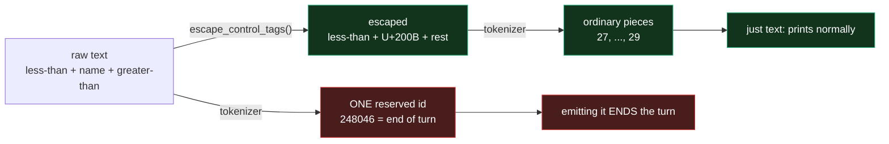
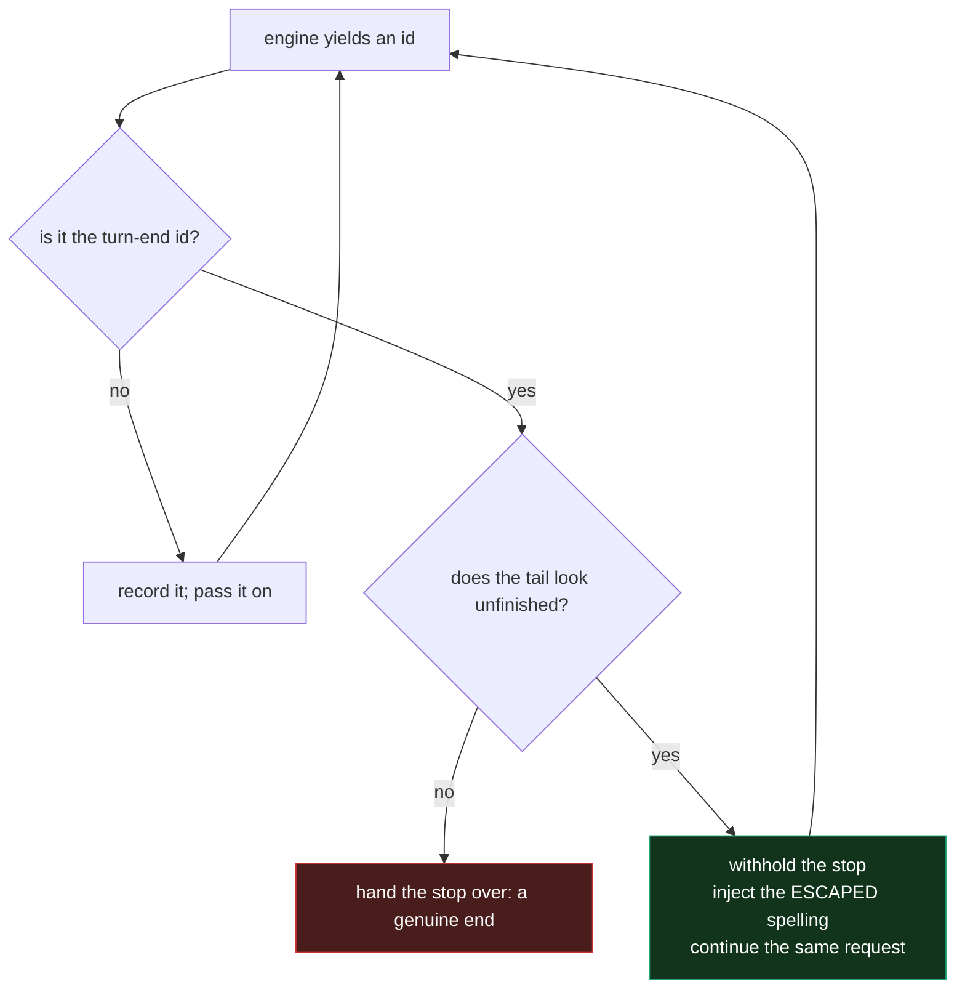
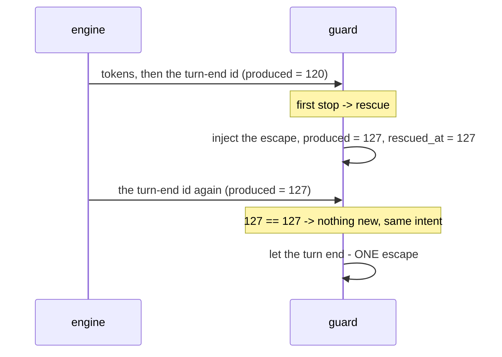

# strata-guard

<p align="left">
  <a href="https://github.com/xhinker/strata-guard/actions/workflows/tests.yml">
    
  </a>
  
  
</p>

**Your model stops mid-sentence, and the API says everything is fine.**

`strata-guard` is a small guard that sits in front of [Strata](https://github.com/Niko1221/Strata)'s
OpenAI-compatible server and fixes two ways a turn gets cut short. It patches the server process
from the outside: no C++ changes, no engine fork, no retraining, no client changes. Remove the flag
and you are back to stock behaviour.

~500 lines of intervention logic (`control_span.py` + `think_split.py`), plus the drop-in launcher
and the tools that measure it.

---

## 1. What this is

A drop-in replacement for `serve/server.py` — `serve_with_guard.py` — that starts the same server,
with the same arguments, and installs two guards into it:

| guard | file | catches |
|---|---|---|
| **control-span guard** | `control_span.py` | a turn that ends while a code block, code span, quote or tag is still open |
| **think-split guard** | `think_split.py` | a reasoning block that ends because the model *quoted* the closing marker |

Both work on the token **id** stream, not on the rendered text, which is what makes them reliable —
see [how it works](#4-how-it-works-internally).

It is not an engine patch, a sampler, or a retry loop. It does not change what the model writes; it
refuses to accept two specific kinds of "the turn is over" that aren't.

### The trap in one picture

A control token has two faces. As **text** it is just characters; as an **id** it is structure.
The model can produce either, and the visible result is identical:



Everything below is a consequence of that picture: the guard decides on the id, and the client
decides which spelling the model sees.

## 2. The two problems it solves

### Problem 1 — the end-of-turn token is also a string the model can type

Qwen's turn-end token is a string that exists in the vocabulary *and* as characters the model can
spell. When the model is inside a code block, a quote, or a tag it is halfway through writing, the
chance of typing it goes up — and it stops. The server sees a legitimate turn-end id, so
`finish_reason` is `"stop"`, HTTP is 200, and the answer ends at a backtick:

````text
```python
print("hi")          <- the answer stops here, inside the code block
````

Nothing in the logs looks wrong. Anything downstream that parses the answer as markdown, extracts a
code block, or feeds the transcript back in as history gets a truncated result.

### Problem 2 — a quoted thinking marker ends the reasoning block

Strata splits reasoning from answer by watching for the **text** of the closing thinking marker. A
model that *quotes* that marker while reasoning — explaining how a chat template closes its thinking
block, say — writes the same characters. From the text side the two are identical, so the split
fires early and the rest of the reasoning is delivered as the answer.

The text cannot tell them apart. **The token id can.** That single observation is the whole design of
`think_split.py`.

## 3. Running it with your Strata

Requirements: a working Strata install with its Python server and a Qwen-family model. Nothing else.

```bash
git clone https://github.com/xhinker/strata-guard.git
```

Start Strata through `serve_with_guard.py` instead of `serve/server.py`, with the arguments you
already use plus one flag:

```bash
cd "$STRATA_ROOT"
STRATA_ROOT="$STRATA_ROOT" .venv/bin/python /path/to/strata-guard/serve_with_guard.py \
    --engine strata --config your-config.json --port 8080 \
    --control-span-guard on
```

### What is `your-config.json`?

It is **Strata's own engine config** — the file you already pass to `serve/server.py --config`. The
wrapper hands it straight to Strata, so it has to be the same file you normally run with; nothing in
this project invents defaults for it.

Find yours with any of these:

```bash
ls "$STRATA_ROOT"/strata-*.json                      # the convention: one file per model
grep -rn -- "--config" ~/bin ~/scripts 2>/dev/null   # whatever your launch script already uses
echo "$STRATA_CONFIG"                                # or the env var the guard's tools read
```

The keys that matter here:

````text
| key                   | why the guard cares                                            |
|-----------------------|----------------------------------------------------------------|
| exe, args, cwd        | what Strata launches; the wrapper passes it through unchanged   |
| tokenizer             | where your pack's tokenizer lives - find_control_ids.py reads it |
| model_name            | what the API reports, and how the guard's log lines identify it |
| port, host, api_key   | the endpoint your client and the probe talk to                  |
| reasoning_close_retry | Strata's own missing-close fix; overlaps rule 5, harmless to both |
````

A trimmed example, taken from a working file — the fields shown are the ones this project reads:

```json
{
  "exe": "/path/to/Strata/engine/strata",
  "args": ["--pack", "/path/to/packs/ud_q4_k_xl", "--native", "/path/to/model.gguf"],
  "cwd": "/path/to/Strata",
  "tokenizer": "/path/to/packs/ud_q4_k_xl/tokenizer",
  "model_name": "qwen3.8-flash-next-ud_q4_k_xl",
  "port": 8080,
  "host": "0.0.0.0",
  "api_key": "your-key",
  "reasoning_close_retry": true
}
```

Two things that trip people up:

- The `--control-span-*` flags in the command above are **the wrapper's**, not Strata's. Keep them out
  of the JSON: the JSON is Strata's, the flags are the guard's, and the wrapper adds its own on top.
- If the file has no `tokenizer` key, `find_control_ids.py` falls back to the `--pack` argument inside
  `args`, which is where the pack path usually lives anyway.


If it took, the first lines are:

```
[control-span] ENABLED (eos ids [248044, 248046], think ids [248068, 248069], window 32, max rescues 5)
[think-split] ENABLED (strict; the pack's reserved marker id is 248069)
```

No upstream file is touched; the patch lives in that process only.

### Configure it for your model — the ids are not universal

The defaults in this repo are the Qwen3.8-Flash-Next pack's ids. **Yours will differ**, and if you
run with someone else's ids the guard never fires: it waits for a turn-end token that your model
never emits, so everything looks installed and nothing happens.

Ask your pack instead of guessing:

```bash
python3 find_control_ids.py --config strata-your-model.json
```

````text
pack: .../packs/ud_q4_k_xl/tokenizer

  end of turn (im_end)       -> [248046]           one token  CONTROL
  end of text (endoftext)    -> [248044]           one token  CONTROL
  start of message           -> [248045]           one token  CONTROL
  thinking open              -> [248068]           one token  USER_DEFINED
  thinking close             -> [248069]           one token  USER_DEFINED

run the guard with:
  --control-span-eos 248046,248044
  --control-span-think 248068,248069
````

Then either pass those flags, or set the environment:

```bash
CONTROL_SPAN_GUARD=on \
STRATA_CONTROL_SPAN_EOS=248046,248044 \
STRATA_CONTROL_SPAN_THINK=248068,248069 \
.venv/bin/python /path/to/strata-guard/serve_with_guard.py --engine strata --config your-config.json --port 8080
```

Three cases worth knowing:

- **A model with no thinking channel** — pass an empty list: `--control-span-think ""`. Rule 5 is then
  simply never true and the other four rules still apply.
- **A single-id turn-end** — pass just that one: `--control-span-eos 248046`.
- **A pack whose markers are not single tokens** — `find_control_ids.py` prints `N pieces` instead of
  `one token`. A marker spelled from several pieces cannot stop a turn on its own, so leave it out;
  the guard only needs the ids that actually appear as one token.

After configuring, one run of `probe_guard.py` tells you whether the ids are right: every POSITIVE
must come back with an escape, and NEGATIVE 1 and 2 must not.

**What is Strata-specific here.** The guard patches `StrataEngine.generate` and reads the pack's own
tokenizer, so it works with any model on any stock Strata install — but it is not portable to vLLM,
llama.cpp or TGI, which have their own stop paths. The *idea* (hold the stop, look at the ids,
escape the tag) travels; this code does not.

### Options

| flag | environment variable | default | meaning |
|---|---|---|---|
| `--control-span-guard on\|off` | `STRATA_CONTROL_SPAN_GUARD` | `off` | enable the control-span guard |
| `--control-span-window N` | `STRATA_CONTROL_SPAN_WINDOW` | `32` | characters inspected at the end of the reply (rules 2–3, and rule 1 when it is enabled) |
| `--control-span-rescues N` | `STRATA_CONTROL_SPAN_RESCUES` | `5` | hard bound on rescues per request (the one-shot rule usually stops at one) |
| `--control-span-scan N` | `STRATA_CONTROL_SPAN_SCAN` | `0` | characters scanned for an open code span/block; `0` = the whole turn |
| `--control-span-eos IDS` | `STRATA_CONTROL_SPAN_EOS` | `248044,248046` | turn-end token ids (Qwen3 / 3.5 / 3.8) |
| `--control-span-think IDS` | `STRATA_CONTROL_SPAN_THINK` | `248068,248069` | think open/close token ids |
| `--control-span-rules SPEC` | `STRATA_CONTROL_SPAN_RULES` | `2,3,4` | which of the four checks run — by id or name, `all`, `none`, or `-N` to subtract (see below) |
| | `STRATA_THINK_SPLIT=strict\|log\|off` | `off` | `strict` undoes a quoted-marker split; `log` only records which id closed the block; `off` installs nothing |

`strict` is the mode to run; `log` is what to run first if you want to see how often each branch
fires on your model before you change behaviour.

### Which rules run, and why rule 1 is off by default

The check for a cut-off reply is four rules. Each one can be switched on or off by itself:

| rule | name | fires when the reply ends… | default |
|---|---|---|---|
| 1 | `quote` | with a double quote that has no closing quote in the last 32 characters | **off** |
| 2 | `dangling` | on a `\|` or an opening backtick — an unfinished token | on |
| 3 | `half-tag` | on a `<` with nothing after it — a half-typed tag | on |
| 4 | `code` | inside a code block or inline span that was never closed (searched over the whole reply) | on |

**Why rule 1 is off.** It counts quotes in the last 32 characters, but "is this quote closed?" is a
question about the whole reply. When a quoted phrase straddles the edge of that window, the window
sees the closing quote without the opening one and calls a finished reply cut off. A real case from
2026-10-27: the reply was 4,685 characters with six quotes, all closed — but the window started at
character 4,653, between the opening quote (4,645) and the closing one (4,661). The rule fired, the
guard rescued a turn that had already ended, and the marker it injected landed in the user's answer.

The same rule also misses real cut-offs: a quote opened before the window plus two inside it counts
as even. Counting over the whole reply doesn't fix it either — prose is full of quotes that quote
nothing (inside code, JSON, tables), and one stray quote early in a long answer would keep the guard
firing for the rest of the turn. Whether a stop is risky depends on how long ago the quote opened,
and no version of this rule looks at that. Rules 2, 3 and 4 don't have the problem: an unfinished
token or an unclosed block really is visible at the end.

### Choosing the rules

One flag, added to the command you already run:

```bash
.venv/bin/python /path/to/strata-guard/serve_with_guard.py \
    --engine strata --config your-config.json --port 8080 \
    --control-span-guard on --control-span-rules 2,3,4
```

| value of `--control-span-rules` | what you get |
|---|---|
| *(omit the flag)* | `2,3,4` — the recommended default |
| `all` | all four: the behaviour this guard had before 2026-10-27 |
| `none` | no span rescue at all — only the thinking-block guard |
| `code` | one rule by name (its id works too: `4`) |
| `2,3,4,quote` | spell the set out; `-1` subtracts from the default instead |

The same setting exists as the environment variable `STRATA_CONTROL_SPAN_RULES`, which is handy when
a script builds the command line for you. A wrong value stops the server at start rather than
quietly running a different check:

```
[control-span] unknown control-span rule id '9' (valid: 1-4, all, none)
```

Whatever is armed is printed on startup, so nothing can be on by accident:

```
[control-span] ENABLED (eos ids [248044, 248046], think ids [248068, 248069],
                        window 32, max rescues 5, rules [2:dangling,3:half-tag,4:code])
```

**What to pick.** The default. Turn rule 1 on only if you are seeing replies cut off *inside a quoted
phrase*, and you accept that it will also touch finished replies that merely quote something.

### The mechanism, exactly — 30 seconds, no GPU

`demo_rescue.py` runs a scripted engine: it writes a code block and then yields the turn-end id
**in the middle of it**, the way a model does when it decides it is done. No model, no GPU, no
waiting — just the two client-side views of the same stream:

```bash
python3 demo_rescue.py
```

````text
without the guard:
  client content: '```python\nprint("hi")\n'
  engine calls   : 1

with the guard:
  client content: '```python\nprint("hi")\n<\u200b|im_end|>```\n'
  engine calls   : 2 | ended on a turn-end id: True
````

The whole trade, in four lines. Without the guard the client receives an unterminated block: the
fence never arrives, and on a real turn neither does anything the model still had to write. With the
guard, the escaped tag goes in, the engine is asked once more, and the block closes. The cost is the
escape; the save is the rest of the deliverable.

### What it does not fire on

Measured on a guarded server, and just as important as the rescue:

````text
a literally written, closed tag    "<zwsp>|im_end|>"          ->  no rescue
finished prose                     "Hello!"                    ->  no rescue
````

### On your own server

```bash
python3 probe_guard.py 8084 "$STRATA_API_KEY"                  # every rule, positive and negative
python3 ab_guard.py 127.0.0.1:8086 127.0.0.1:8085 "$KEY"       # same prompts, two servers
```

Both print answers with `repr()`, because the escape contains U+200B — invisible in a terminal, a
browser and a diff. Comparing by eye is the usual way to conclude "no difference" when the difference
is one invisible character.

### The cases it covers

````text
| rule | the reply ends with                     | guard? | what you get                     |
|------|-----------------------------------------|--------|----------------------------------|
| R1   | an odd number of double quotes          | opt-in | ...hello<\u200b|im_end|>  (`--control-span-rules all`) |
| R2   | a trailing backtick or pipe             | yes    | ...used<\u200b|im_end|>          |
| R3   | a half-typed tag: <|im, <|, <           | yes    | <|im<\u200b|im_end|>             |
| R4   | an open code block or code span         | yes    | closed content + one escape      |
| R5   | thinking opened, never closed           | yes    | closes it, then answers          |
| --   | a finished tag: <​think><​/think>       | no     | unchanged                        |
| --   | finished prose: Hello!                  | no     | unchanged                        |
| --   | an OpenAI stop string, max_tokens, loop | no     | unchanged (a different code path)|
````

### The thinking-split, measured

`think_split.py` answers a different question — *which id closed the reasoning block?* — so it is
checked by log, not by output:

```bash
python3 probe_think_split.py --url http://127.0.0.1:8084/v1 --tmux strata
```

````text
[think-split] reasoning -> content by id 248069: RESERVED id -> the model really closed its thinking
[think-split] reasoning -> content by id 29:     SPELLED out of ordinary tokens -> a quoted marker
````

The first line is a normal turn (248069 is the pack's close id). The second is the failure: id 29 is
`>`, the last ordinary piece of a *spelled* marker — the model was writing the characters, not
closing its thinking. Under `STRATA_THINK_SPLIT=strict` that split is undone and the text stays in
the reasoning channel where it belongs.

## 4. How it works internally

### Holding the stop back instead of dropping it




The guard wraps the engine's token generator. It forwards everything the engine yields — including
the `None` heartbeats it emits while idle — and when a **turn-end id** arrives it does not pass it
on. It holds it and decides:

```
on a turn-end id: hold it, decode the text, evaluate the predicate
  inside a span / open thinking block -> yield the ESCAPED spelling of the turn-end token,
                                        re-invoke the engine, continue   (up to --control-span-rescues)
  otherwise                           -> hand the held id back, so the caller sees a normal stop
```

Why the decision has to happen *at* the stop id: the server ends a turn the moment it sees one —

```python
if t in self.stop_ids:
    finish = "stop"
    break
```

— and that `break` closes the wrapping generator where it is sitting. A guard that inspects the
stream *after* its own loop never runs in production. And the held id must be handed back on a
normal ending, or the client's `finish_reason` silently degrades from `stop` to `length`.

### The predicate

"Inside a span" is true when the turn ends with:

1. an odd number of `"` in the last N characters, or
2. a `|`, an opening backtick, or
3. a `<` with no `>` and no whitespace after it, or
4. **an open code block or code span anywhere in the turn**, or
5. **an open thinking block** — the most recent think tag in the generated ids is the *open* id.

Rules 1–3 are deliberately local. Global quote parity was tried; one lone quote several hundred
characters back kept the guard intervening forever. Rule 4 cannot be local — a code block is longer
than any tail — and it cannot be windowed either. Rule 5 is id-based, so it cannot fire on quoted
text.

**The window bug, because it is the instructive one.** The span check used to be handed the last 64
token ids of everything generated. Two failures followed, both measured: a window that starts
*inside* a code block reads that block's closing fence as an opening one, so a complete answer looks
truncated (`keep=64` said truncated; `keep=128`, `256` and the full length all said complete); and
the reasoning block is prose *about* code — stray backticks, nested quoting — whose parity says
nothing about whether the answer is finished. `Guard.answer_text()` now decodes **only the answer**:
everything after the most recent think-close id, with no cap. Parity is only meaningful over a whole
turn, which is also why `--control-span-scan` defaults to `0`.

### Why the escape, and not the token

The model stopped early because the turn-end token is a string it can type — so the guard cannot
push it back through the door it came in through. It appends the **escaped spelling**: `<` + U+200B +
`|im_end|>`, a sequence of ordinary characters that cannot re-tokenise into the reserved id. The
model reads it as "you wrote the tag as text" — a hint, not a stop. The same escaping is already
used for control tokens in the prompt, so the convention is not new to it.

### One rescue per span, not one per stop

A rescue does not change the condition that triggered it — the fence, the quote or the thinking
block is still open — so the next stop looks identical. Left alone, that turns one quoted marker
into a burst of escapes: five in the first version, one per rescue, all the way to the cap.

The rule is one snapshot, taken right after the escape is injected:

```python
for t in esc:
    produced.append(t)
    yield t
rescued_at = len(produced)      # "nothing new" is measured from here
```



If the model writes anything after the escape the count differs, and a second rescue is legitimate:

````text
| Pass | len(produced) | rescued_at | What arrived                    | Action        |
|------|---------------|------------|---------------------------------|---------------|
| 1    | 120           | None       | a stop inside a span            | rescue        |
| 2    | 127           | 127        | a stop, nothing written between | end the turn  |
| 2    | 167           | 127        | a stop after 40 new tokens      | rescue again  |
````

The escape the model asked for is already in the stream, so a stop right after it is the same
"I am finished" said twice. `--control-span-rescues` stays as the hard bound for a model that keeps
reopening spans.

### The same principle, applied to the thinking block

`think_split.py` patches two server internals — `Detokenizer.push` records the id just decoded,
`OutputParser.feed` notices a reasoning→content transition — and reports which id completed the
marker:

```
[think-split] reasoning -> content by id 248069: RESERVED id -> the model really closed its thinking
[think-split] reasoning -> content by id 2: SPELLED out of ordinary tokens -> a quoted marker
```

In `strict`, the second branch is undone: the parser's state goes back to reasoning, the `content`
events from that batch are rewritten as `reasoning`, and the quoted marker is re-inserted in the
escaped spelling so a downstream splitter that matches raw tag text does not read it as a real close.

Two deliberate no-ops, so it can only ever fail safe:

- if the split released `tool_call` events it is left alone — those cannot be un-emitted;
- if the pack has **no** reserved id for the marker, every close is spelled and a spelled close
  carries no information, so nothing is rewritten.

### What it does not do

- It only sees stops caused by the **turn-end token**. A reply ended by an OpenAI `stop` string, a
  degenerate-repeat stop, or the engine's loop recovery is a different code path.
- It does not touch `max_tokens` truncation. Hitting the token budget is not a control-span stop,
  and rescuing it would be wrong.
- It cannot know whether the model *meant* to stop inside a quote. If it did, the guard spends up to
  N extra engine calls and appends the escape. That is the cost, bounded by `--control-span-rescues`.
- It changes the answer text by the escape sequence — one per rescue, and one rescue per burst of
  output, so the common case appends exactly one. To hide it entirely, filter `<` + U+200B +
  `|im_end|>` client-side.

## 5. Tests

```bash
python3 test_control_span.py             # predicate + rule-selector cases, no GPU (runs in CI)
python3 test_think_split.py              # reserved-id vs spelled-marker, log and strict, offline
STRATA_ROOT=/path/to/strata python3 test_integration.py
STRATA_ROOT=/path/to/strata python3 test_real_engine_shape.py
STRATA_ROOT=/path/to/strata python3 test_server_consumer_shape.py
```

The last one matters most. A guard on a generator is only as alive as its consumer, so those tests
drive it the way the real server does — breaking at the first turn-end id, emitting `None` heartbeats
while idle. Running a generator to exhaustion proves the logic and nothing about production. The first
two need nothing but Python; the rest need a real Strata install and its tokenizer, which is what
makes them exercise the engine's actual output shape rather than a convenient one.

## 6. Files

| file | |
|---|---|
| `serve_with_guard.py` | drop-in replacement for `serve/server.py`; installs both guards |
| `control_span.py` | the control-span guard and its predicate |
| `think_split.py` | the think-split guard: which id closed the thinking block, and what to do |
| `stats_from_log.py` | optional: reads the engine's own log to fill in usage stats |
| `find_control_ids.py` | prints your pack's control ids and the flags to run with |
| `demo_rescue.py` | the mechanism on a scripted engine: no model, no GPU |
| `probe_guard.py` | live probe against one running server |
| `ab_guard.py` | the same prompts against two servers, verdict per case |
| `probe_think_split.py` | provoke a quoted marker and show what was logged |
| `test_*.py` | offline, engine-shaped and consumer-shaped tests |
| `SPEC.md` | the design, decision table and the reasoning behind each rule |

## 7. Contributing

The two things that move this forward are more measured pairs — a prompt, the output without the
guard, the output with it — and test cases for the predicate. If the guard should have rescued a
reply and did not, or rescued one it should not have, open an issue with the prompt and both outputs:
that is the whole bug report.

The defaults were chosen on one model on one machine and are very likely wrong for yours.
`--control-span-rescues`, `--control-span-window` and `STRATA_THINK_SPLIT` are the settings worth
tuning; a predicate tuned for a model that writes prose will misjudge one that writes code.

## License

MIT — see [LICENSE](LICENSE).
